# Módulo 02 - Conectando S3 privado, CloudFront e OAC com Terraform usando referências entre recursos, for_each e depends_on

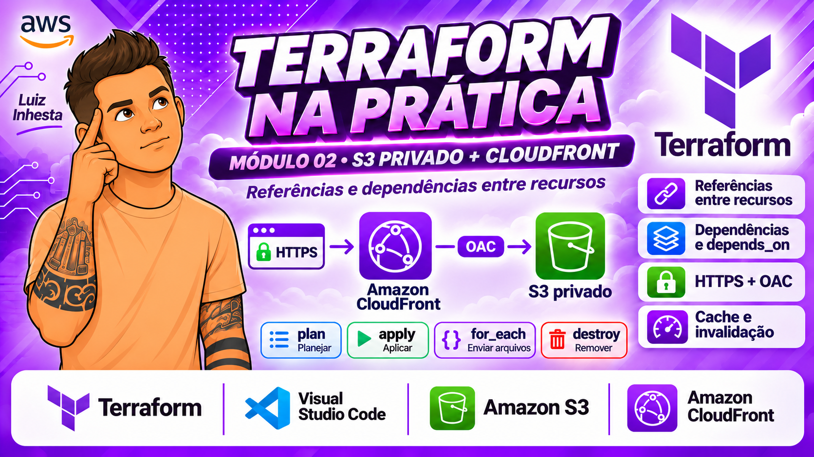

## Artigo: do código ao site no ar, sem clicar no console

### O que é este projeto

Este módulo faz parte do repositório **Terraform na Prática**. Ele publica uma landing page (a "CloudNova") na AWS usando apenas código Terraform. O site fica em um bucket S3 **privado**, e quem o entrega ao mundo, por HTTPS, é o **Amazon CloudFront**. Não há servidor, nem domínio próprio, nem Route 53. A URL final tem o formato `https://<id>.cloudfront.net`.

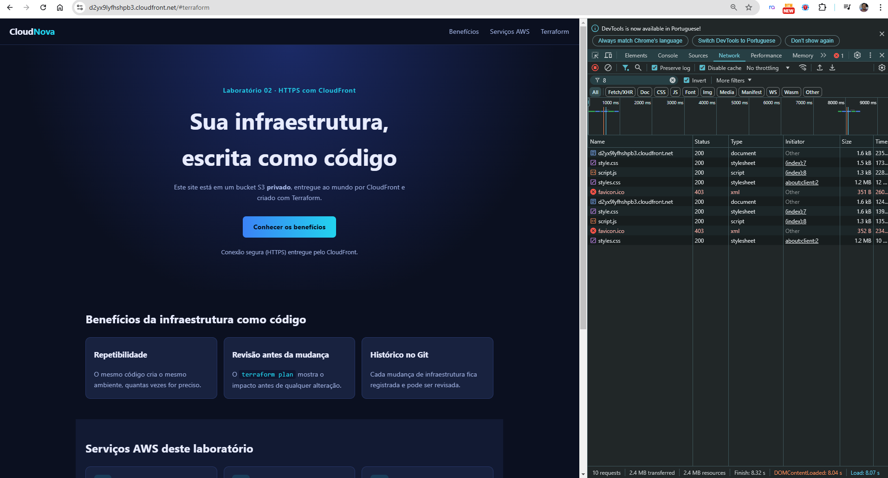

*O resultado: a página abre em `cloudfront.net` e os arquivos CSS e JS chegam com status 200.*

### Por que isso importa

No Módulo 01 criamos um recurso isolado. Na prática, quase nada na nuvem vive sozinho. Aqui há bucket, controle de acesso, CDN, política e arquivos, todos ligados entre si. A pergunta do módulo é: **como o Terraform sabe em que ordem criar cada coisa?**

### Como a solução funciona

```
Navegador --HTTPS--> CloudFront (*.cloudfront.net)
                         |  (OAC: requisições assinadas)
                         v
                 Bucket S3 PRIVADO (endpoint REST)
```

- O **bucket** bloqueia todo acesso público.
- O **OAC (Origin Access Control)** faz o CloudFront assinar as requisições enviadas ao S3.
- A **bucket policy** libera a leitura apenas para a distribuição específica, usando a condição `AWS:SourceArn`.
- Os **arquivos** da pasta `application/` são enviados pelo Terraform com `fileset` e `for_each`.

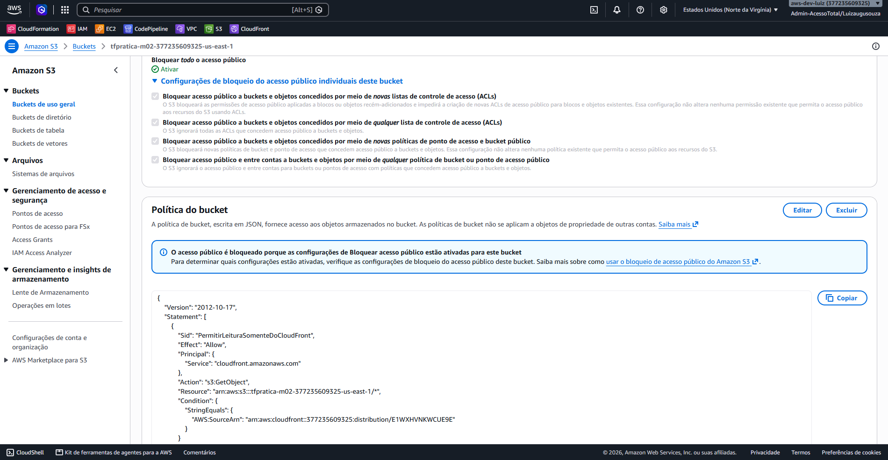

*O bucket é privado, e só a distribuição do laboratório consegue ler os objetos.*

### O que fizemos

1. **Escrevemos a infraestrutura** em quatro arquivos: `versions.tf` (versões), `providers.tf` (região e tags padrão), `main.tf` (recursos) e `outputs.tf` (saídas).
2. **Validamos** com `terraform init`, `fmt` e `validate`.
3. **Planejamos e aplicamos**: 8 recursos criados. A distribuição levou cerca de 2m45s, e a bucket policy só foi criada depois dela.
4. **Conferimos no console da AWS** que o criado era o esperado: origem, comportamento de cache, objetos, tags e policy.
5. **Testamos** o site por HTTPS.
6. **Alteramos o conteúdo** e vimos o `plan` detectar a mudança, mas o site continuar com a versão em cache até criarmos uma invalidação.
7. **Fizemos os exercícios**: alterar, criar e remover arquivos, e ler o `terraform show`.
8. **Destruímos tudo** com `terraform destroy`.

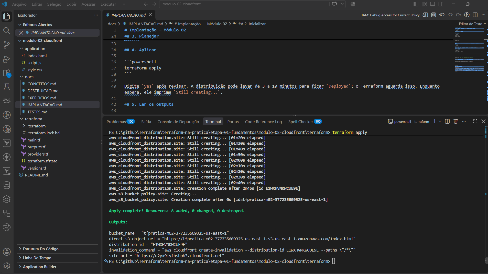

*O `apply` termina com `8 added, 0 changed, 0 destroyed` e imprime os outputs, entre eles a URL do site.*

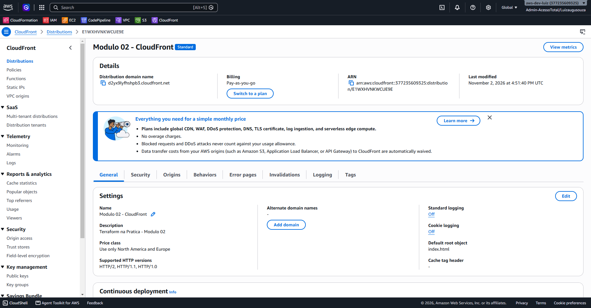

*A mesma distribuição vista no console. O domínio e o ARN foram gerados pela AWS durante o `apply`.*

### O que aprendemos

**1. O Terraform monta a ordem sozinho.** Quando um recurso referencia outro (`aws_cloudfront_distribution.site.arn`), cria-se uma dependência **implícita**. A bucket policy usa o ARN da distribuição, então o Terraform cria a distribuição primeiro. Ninguém escreveu essa ordem.

**2. Atributos computados só existem depois.** `arn`, `id` e `domain_name` aparecem como `(known after apply)` no plano. Depois do `apply`, ficam guardados no state e podem ser lidos com `terraform show`.

**3. `depends_on` é para o que o Terraform não enxerga.** O bloqueio de acesso público e a policy não se referenciam, mas a AWS pode rejeitar duas alterações simultâneas no mesmo bucket. O `depends_on` documenta e força essa ordem. O `plan` não mostra esse risco, porque ele não simula o comportamento da AWS.

**4. O `plan` é uma conversa antes da mudança.** Cada símbolo conta uma história:

| Símbolo | Significado | Exemplo real deste lab |
|---|---|---|
| `+` | criar | novo arquivo `sobre.html` |
| `~` | alterar no lugar | mudar o `comment` da distribuição, ou o conteúdo de `style.css` |
| `-/+` | substituir | mudar o nome do bucket |
| `-` | destruir | arquivo removido depois de ter sido aplicado |

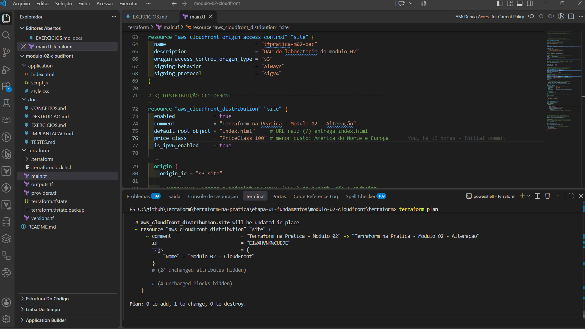

*Mudar o `comment` gera `~ update in-place`: 1 alteração, nada recriado.*

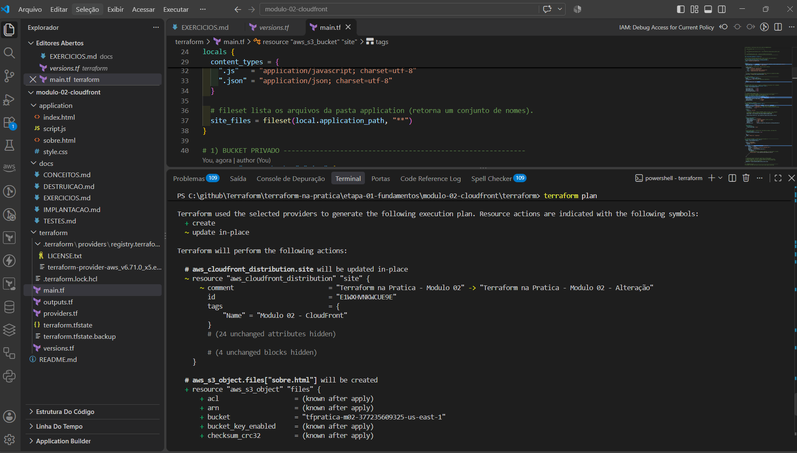

*Um arquivo novo na pasta vira `+ create` para `aws_s3_object.files["sobre.html"]`.*

**5. O state é a memória do Terraform.** Ao apagar o `sobre.html` antes de aplicar, o `plan` não mostrou nenhuma destruição. O arquivo nunca tinha entrado no state, então não havia o que remover. Esse detalhe confunde muita gente, e vale lembrá-lo.

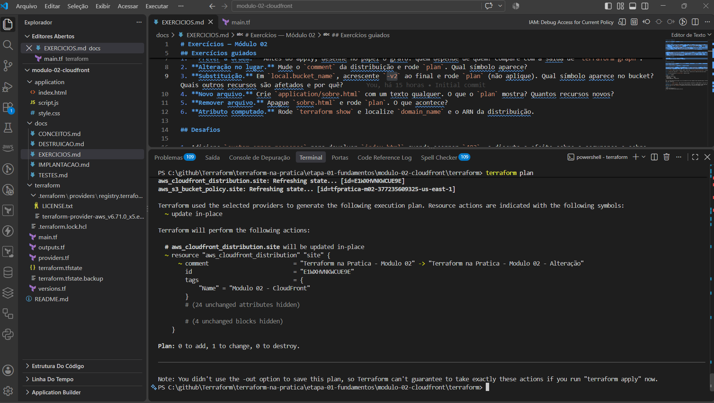

*Sem `apply` prévio, não há `-` no plano. Só permanece a alteração pendente do `comment`.*

**6. Atualizar o S3 não atualiza o CDN.** O Terraform troca o objeto no bucket, mas o CloudFront continua entregando a cópia em cache. Para ver a mudança na hora, é preciso criar uma **invalidação**. O output `invalidation_command` apenas mostra o comando. Quem o executa é você.

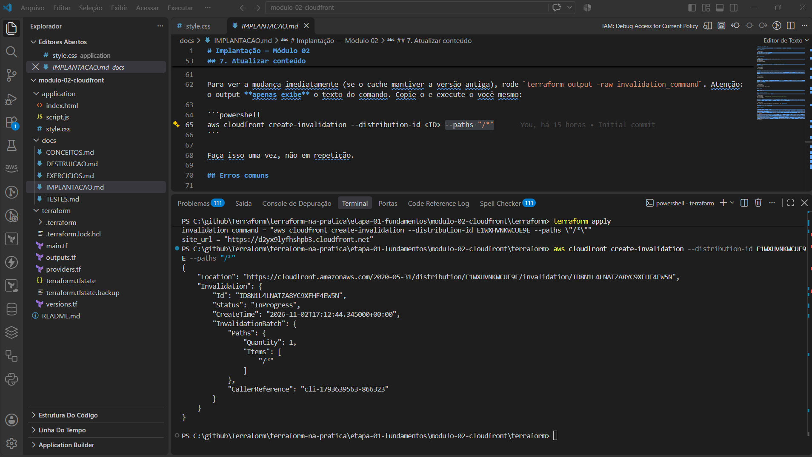

*A invalidação nasce como `InProgress`...*

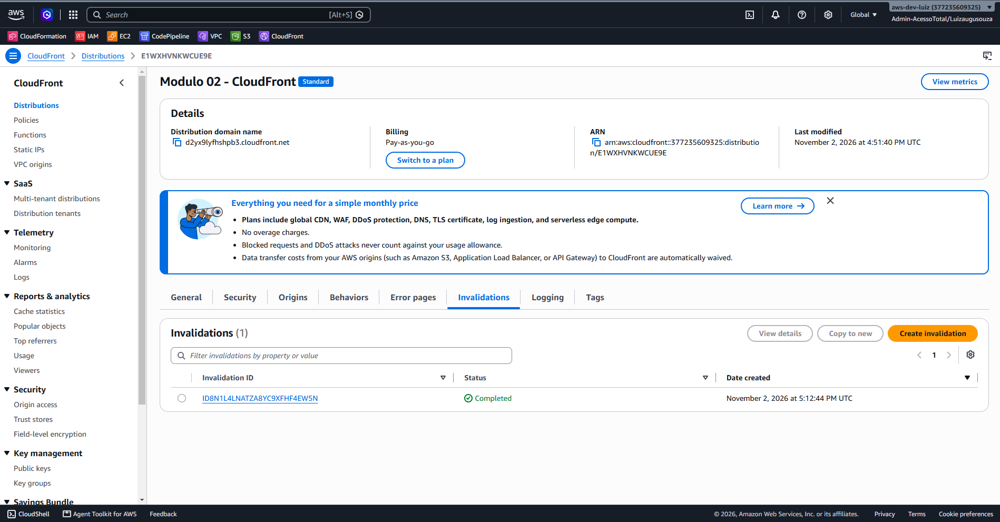

*...e termina como `Completed`. Depois disso, o site mostra o conteúdo novo.*

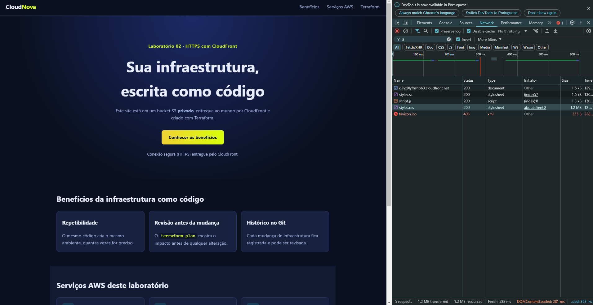

*O novo estilo (destaques em amarelo) aparece depois da invalidação.*

**7. Segurança por padrão.** Bucket privado, OAC e policy com `AWS:SourceArn` impedem acesso direto ao S3. Credenciais vêm do perfil da AWS CLI (SSO), nunca do código.

**8. Destruir também tem ordem.** O `destroy` percorre o grafo ao contrário: policy, objetos, bloqueio público, distribuição e bucket. A distribuição é a parte mais lenta, pois precisa ser desabilitada antes de excluída.

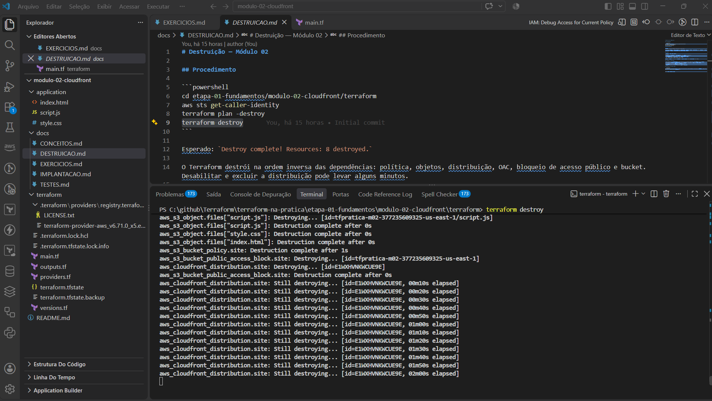

*A ordem inversa em ação. A distribuição fica em `Still destroying...` enquanto os demais recursos já foram removidos.*

### E o que fazemos com isso

- **Publicar sites estáticos de forma repetível.** O mesmo código cria o mesmo ambiente quantas vezes for preciso, em qualquer conta.
- **Revisar infraestrutura antes de mudar.** O `terraform plan` funciona como um code review do que vai acontecer na AWS.
- **Base para os próximos módulos.** Variáveis e outputs completos (módulo 03), state e drift (módulo 04) e módulos reutilizáveis nas etapas seguintes.
- **Levar o padrão para outros projetos.** O trio "bucket privado + CloudFront + OAC" é a forma recomendada de servir conteúdo estático na AWS, e vale para blogs, documentação e front-ends de aplicações de página única.
- **Controlar custos.** Como tudo está em código, `terraform destroy` remove o laboratório inteiro e evita cobranças esquecidas.

### Para refazer o laboratório

Siga os documentos na ordem: [CONCEITOS](docs/CONCEITOS.md), [IMPLANTACAO](docs/IMPLANTACAO.md), [TESTES](docs/TESTES.md), [EXERCICIOS](docs/EXERCICIOS.md) e [DESTRUICAO](docs/DESTRUICAO.md). Todos trazem as capturas de tela da execução real, que estão na pasta [imagens](imagens/).

> As capturas de tela mostram identificadores reais da conta AWS usada no laboratório (ID da conta, nome do bucket e ID da distribuição). Se for publicar este repositório, avalie ocultar ou cobrir esses dados.

---

## Objetivo

Aprender como o Terraform relaciona **vários recursos** entre si: referências, atributos computados, dependências implícitas e explícitas, e a diferença entre criar, alterar e substituir.

## Progressão didática

| Nível | Conceitos |
|---|---|
| **Foco** | Referências entre recursos (`tipo.nome.atributo`), atributos computados, dependências implícitas e explícitas (`depends_on`), criar x alterar x substituir, leitura do `plan` |
| **Apoio** | `data` para buscar a política de cache pelo nome, `locals`, `fileset` e `for_each` (para enviar vários arquivos), `lookup`, `try` e `regex` (para o Content-Type), `jsonencode` |
| **Próximas etapas** | Variáveis e outputs completos (módulo 03); state e drift (módulo 04); `for_each` avançado, `count` e módulos reutilizáveis (etapas futuras) |

Os conceitos de apoio têm explicações curtas em [CONCEITOS.md](docs/CONCEITOS.md#conceitos-de-apoio).

## Pré-requisitos

- Terraform CLI 1.5+ e AWS CLI com sessão SSO ativa.
- Permissão para criar S3, CloudFront (distribuição e OAC) e políticas de bucket.
- Este módulo **não** depende do módulo 01. Cada um tem state próprio.

## Diagrama da arquitetura

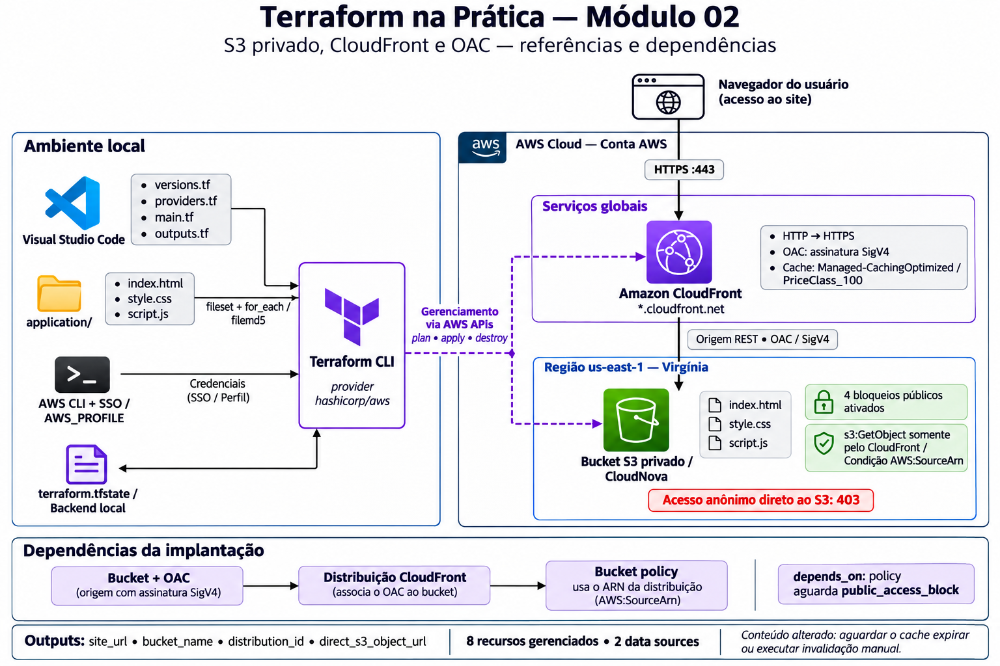

O detalhamento está em [docs/ARQUITETURA.md](docs/ARQUITETURA.md).

## Arquitetura (textual)

```
Navegador --HTTPS--> CloudFront (domínio *.cloudfront.net)
                         |  (OAC: requisições assinadas)
                         v
                 Bucket S3 PRIVADO (endpoint REST)
```

Importante: a origem usa o **endpoint REST** do bucket (`bucket_regional_domain_name`). O OAC não funciona com o endpoint de S3 Website Hosting. Sem Route 53 nem domínio próprio.

## Recursos criados

| Recurso Terraform | Função | Custo |
|---|---|---|
| `aws_s3_bucket.site` | Bucket privado | Armazenamento mínimo |
| `aws_s3_bucket_public_access_block.site` | Bloqueia todo acesso público | Sem custo |
| `aws_cloudfront_origin_access_control.site` | Assina requisições ao S3 | Sem custo |
| `aws_cloudfront_distribution.site` | CDN com HTTPS | **Pode gerar custo** (requisições e transferência; há free tier por conta) |
| `aws_s3_bucket_policy.site` | Permite leitura só pela distribuição | Sem custo |
| `aws_s3_object.files[...]` (3) | `index.html`, `style.css`, `script.js` | Armazenamento mínimo |
| `data` sources | Conta atual e política de cache gerenciada | Sem custo |

Total esperado no primeiro plano: **8 recursos**.

## Resultado esperado

Output `site_url` no formato `https://<id>.cloudfront.net`. A criação da distribuição costuma levar alguns minutos. A URL só existirá após o seu `apply`.

## Comandos resumidos

```powershell
cd etapa-01-fundamentos/modulo-02-cloudfront/terraform
$env:AWS_PROFILE = "<seu-perfil>"
terraform init
terraform validate
terraform plan
terraform apply
terraform output site_url
terraform destroy
```

## Documentação

[CONCEITOS](docs/CONCEITOS.md) · [IMPLANTACAO](docs/IMPLANTACAO.md) · [TESTES](docs/TESTES.md) · [EXERCICIOS](docs/EXERCICIOS.md) · [DESTRUICAO](docs/DESTRUICAO.md)
