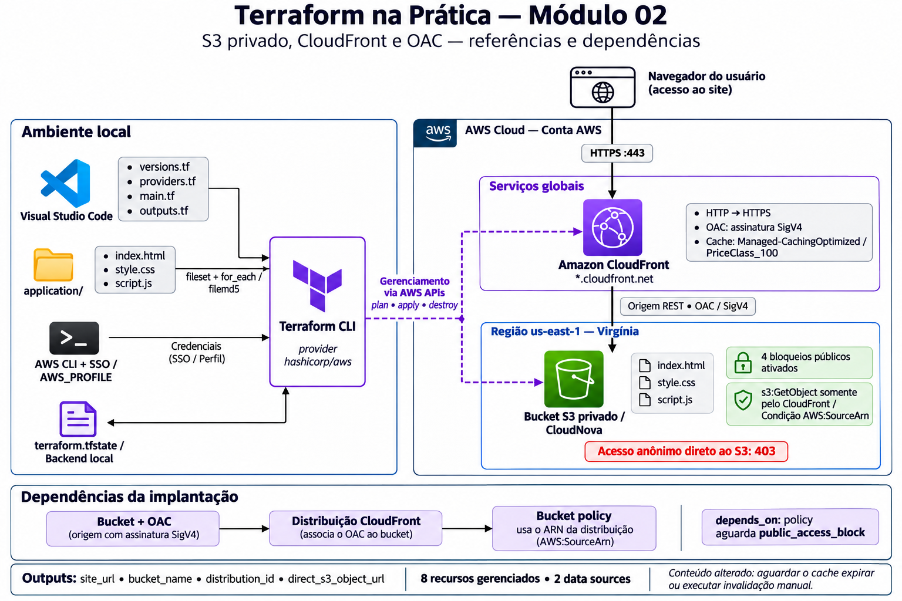
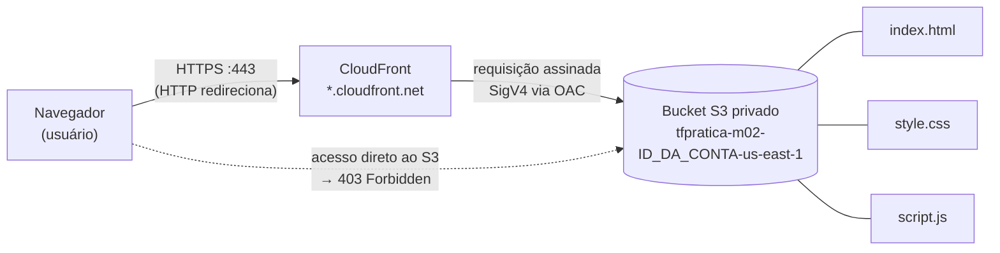
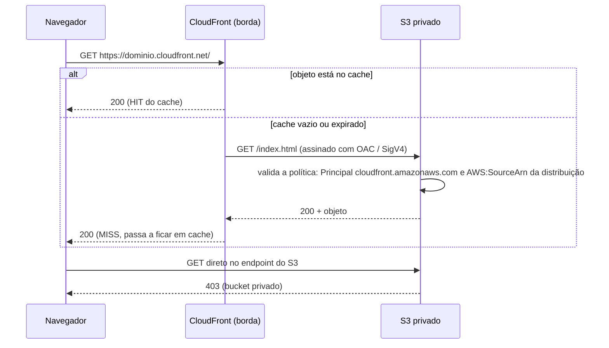
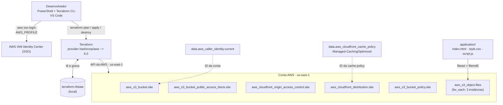
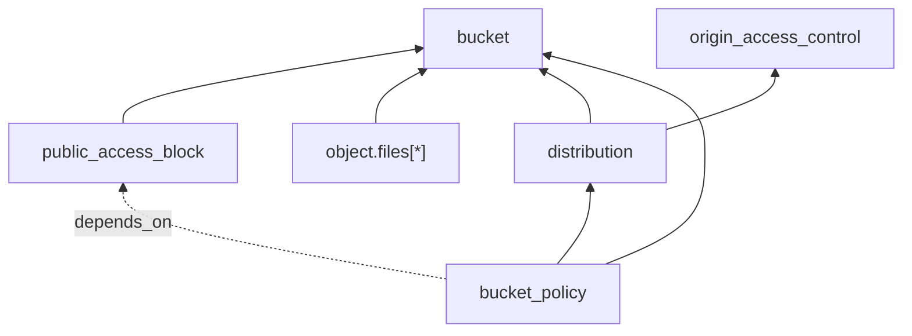
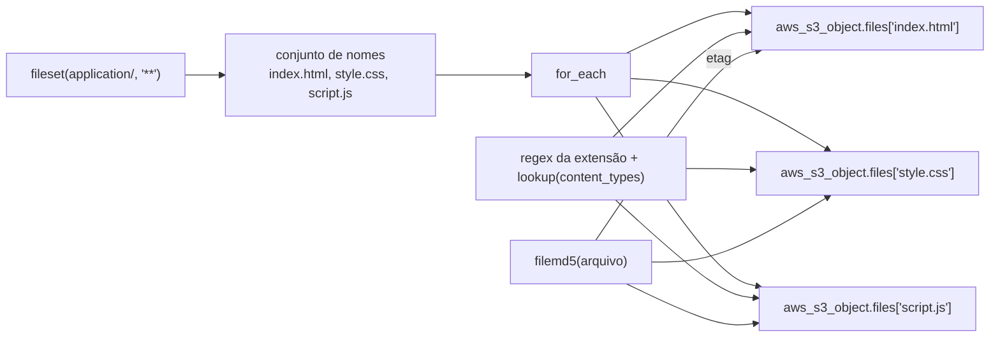
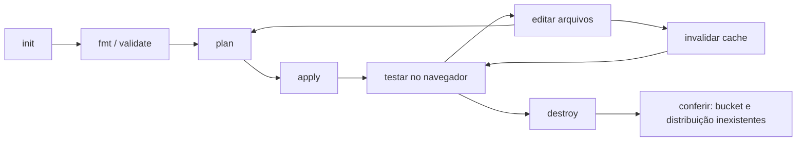

# Arquitetura — Módulo 02

Este documento descreve o que foi construído no laboratório: quais recursos existem na AWS, como eles se relacionam e como o Terraform os cria.

> Os diagramas usam Mermaid. No VS Code, abra o preview com `Ctrl+Shift+V` e instale a extensão **Markdown Preview Mermaid Support** (`bierner.markdown-mermaid`) para vê-los renderizados.

## Diagrama da arquitetura

## Visão geral

O usuário acessa o site por HTTPS no domínio `*.cloudfront.net`. O CloudFront entrega o conteúdo e busca os arquivos em um bucket S3 **privado**. O bucket não aceita acesso público: só a distribuição CloudFront, identificada pelo ARN, pode ler os objetos. Não há domínio próprio nem Route 53.

## Fluxo de uma requisição

## Arquitetura de implantação (quem cria o quê)

## Dependências entre os recursos

O Terraform monta um grafo a partir das referências. Setas indicam "depende de".

- A distribuição depende do bucket (usa `bucket_regional_domain_name`) e do OAC (usa `origin_access_control_id`).
- A política do bucket depende da distribuição, porque precisa do ARN dela. Esse ARN só existe depois que a distribuição é criada.
- A política também depende do `public_access_block` por `depends_on` **explícito**. Os dois recursos não se referenciam, e a AWS pode rejeitar alterações simultâneas no mesmo bucket (`OperationAborted`).
- Ordem resultante no `apply`: bucket e OAC → distribuição e bloqueio de acesso público → política e objetos.
- A criação da distribuição é a etapa mais demorada (alguns minutos).

## Componentes

| Componente | Recurso Terraform | Responsabilidade |
|---|---|---|
| Bucket privado | `aws_s3_bucket.site` | Guarda os arquivos do site. Nome: `tfpratica-m02-<id-da-conta>-us-east-1` |
| Bloqueio de acesso público | `aws_s3_bucket_public_access_block.site` | Liga os quatro bloqueios (`block_public_acls`, `ignore_public_acls`, `block_public_policy`, `restrict_public_buckets`) |
| Origin Access Control | `aws_cloudfront_origin_access_control.site` | Faz o CloudFront assinar as requisições ao S3 (`sigv4`, `signing_behavior = always`) |
| Distribuição | `aws_cloudfront_distribution.site` | Entrega o site por HTTPS, redireciona HTTP, usa `index.html` como raiz e `PriceClass_100` |
| Política do bucket | `aws_s3_bucket_policy.site` | Permite `s3:GetObject` somente ao serviço `cloudfront.amazonaws.com` com `AWS:SourceArn` igual ao ARN da distribuição |
| Objetos | `aws_s3_object.files` | Um objeto por arquivo de `application/`, criado com `for_each`, com `content_type` e `etag` |
| Cache policy gerenciada | `data.aws_cloudfront_cache_policy.caching_optimized` | Busca pelo nome `Managed-CachingOptimized`, sem fixar o ID no código |
| Identidade da conta | `data.aws_caller_identity.current` | Lê o ID da conta para compor o nome único do bucket (não cria nada) |

Total: **8 recursos gerenciados** (bucket, bloqueio, OAC, distribuição, política e 3 objetos) mais 2 data sources.

## Como o Terraform trata os arquivos do site

- Adicionar um arquivo em `application/` cria uma nova instância. Remover um arquivo destrói só a instância correspondente.
- Alterar o conteúdo muda o `etag` e gera um `update in-place` apenas naquele objeto.
- Alterar o conteúdo **não** limpa o cache do CloudFront. Para ver a mudança de imediato, é preciso uma invalidação (output `invalidation_command`, executado manualmente).

## Outputs

| Output | Conteúdo | Uso |
|---|---|---|
| `site_url` | `https://<domínio>.cloudfront.net` | Abrir o site |
| `bucket_name` | Nome do bucket | Conferir no console do S3 |
| `distribution_id` | ID da distribuição | Invalidações de cache |
| `direct_s3_object_url` | URL direta do objeto no S3 | Deve retornar **403** |
| `invalidation_command` | Comando `aws cloudfront create-invalidation` | Limpar o cache após atualizar arquivos |

## Decisões de arquitetura

| Decisão | Motivo | Limitação |
|---|---|---|
| Bucket privado + CloudFront com OAC | O S3 não fica exposto; o acesso passa por HTTPS e pela CDN | Mais recursos e mais tempo de criação que o módulo 01 |
| Endpoint **REST** do bucket como origem | O OAC não funciona com o endpoint de website do S3 | Não há `index.html` automático em subpastas; só a raiz usa `default_root_object` |
| Política com `AWS:SourceArn` | Apenas esta distribuição lê o bucket, não qualquer CloudFront da AWS | A política depende do ARN, criando uma ordem rígida de criação |
| `redirect-to-https` | Todo acesso termina em HTTPS | O certificado é o padrão `*.cloudfront.net`; não há domínio próprio |
| `PriceClass_100` | Menor custo (América do Norte e Europa) | Latência maior em outras regiões |
| `for_each` + `fileset` | Novos arquivos entram no deploy sem alterar o código | Arquivos sem extensão mapeada saem como `application/octet-stream` |
| `depends_on` entre política e bloqueio | Evita erro de alteração concorrente no bucket | Dependência que o Terraform não infere sozinho |
| `force_destroy = true` | Permite `terraform destroy` com objetos dentro | Em produção, apagaria dados sem aviso |
| State local | Simplicidade para o laboratório | Sem trava compartilhada nem backup remoto |
| Credenciais via SSO e `AWS_PROFILE` | Nenhuma chave no código | Sessão expira e exige novo `aws sso login` |

## Segurança

- Nenhuma chave de acesso no código; as credenciais vêm do AWS CLI.
- O bucket mantém os quatro bloqueios de acesso público ligados.
- A política concede somente leitura (`s3:GetObject`) e somente para esta distribuição.
- O `favicon.ico` retorna 403 porque o site não tem esse arquivo; o S3 privado responde 403 para chaves inexistentes. Isso não indica falha.
- O `terraform.tfstate` contém ID da conta e ARNs. Ele está no `.gitignore` e **não** deve ser publicado.

## Custos e limpeza

- O CloudFront cobra por requisições, transferência de dados e invalidações. O S3 cobra por armazenamento e requisições (valores baixos para o laboratório).
- Destrua ao final com `terraform destroy`. A remoção da distribuição pode levar alguns minutos. Veja [DESTRUICAO.md](DESTRUICAO.md).

## Ciclo de vida do laboratório

## Evidências do laboratório

Resultado do `apply` com os outputs:

Detalhes da distribuição no CloudFront:

Origem apontando para o bucket S3:

Comportamento de cache:

Objetos no bucket:

Bloqueio de acesso público e política do bucket:

Site aberto por HTTPS:

Acesso direto ao S3 bloqueado (403):

Para o passo a passo completo, veja [IMPLANTACAO.md](IMPLANTACAO.md). Para os conceitos por trás de cada bloco, veja [CONCEITOS.md](CONCEITOS.md).
