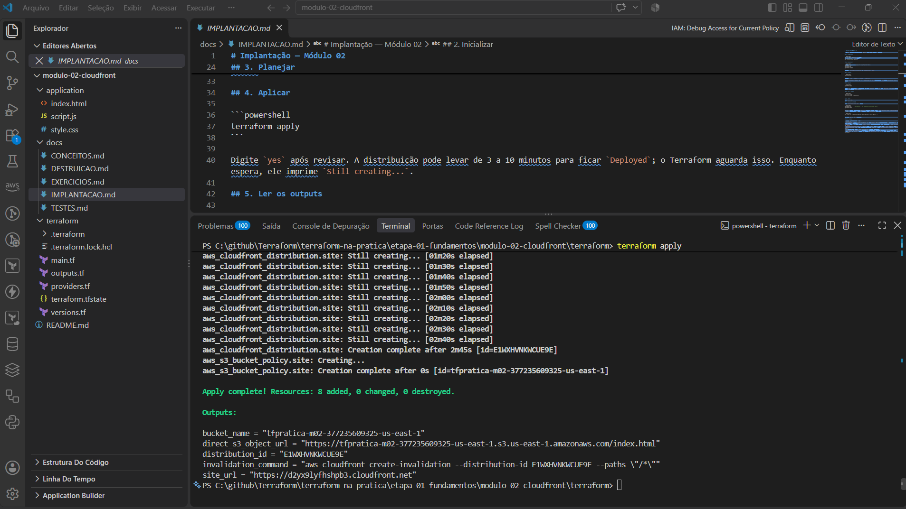
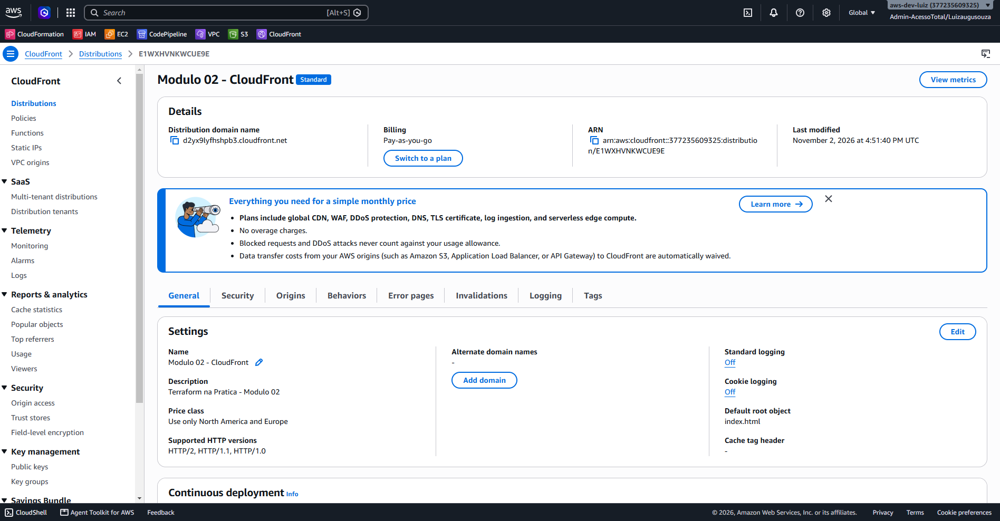
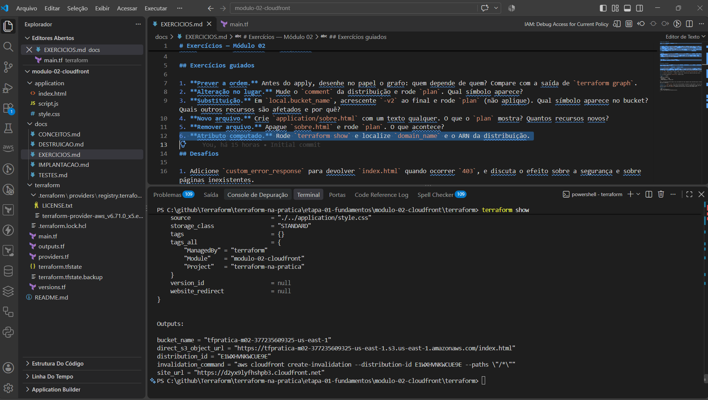
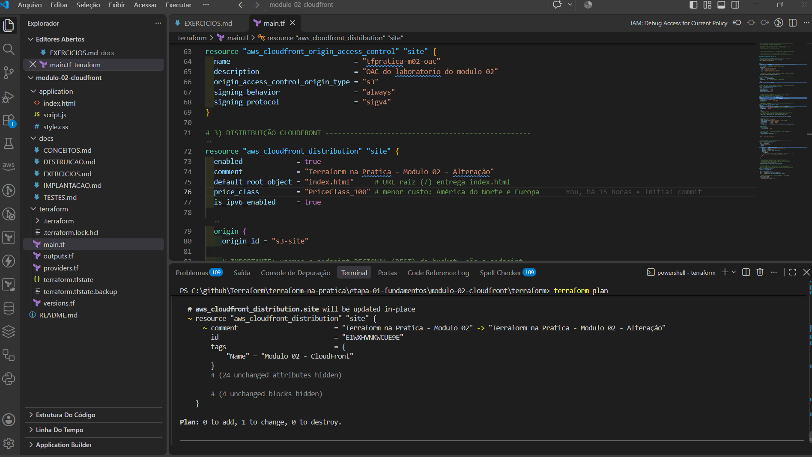
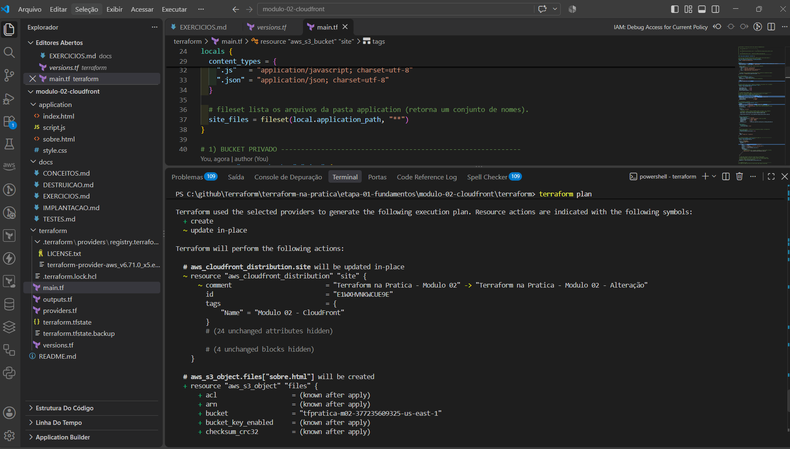
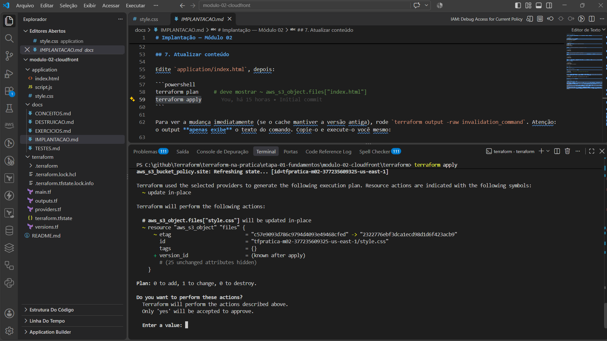
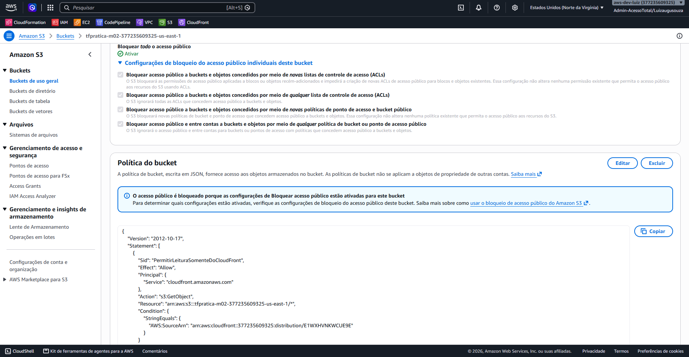
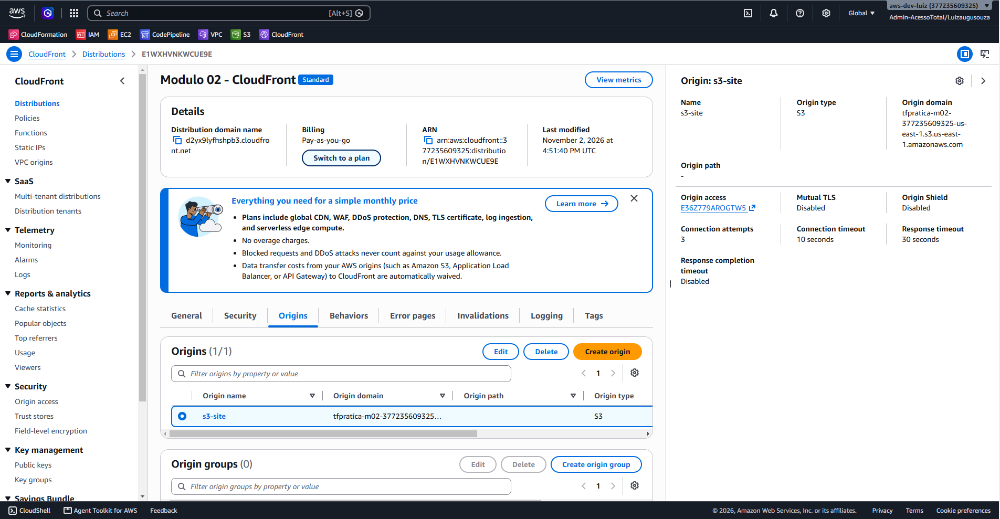
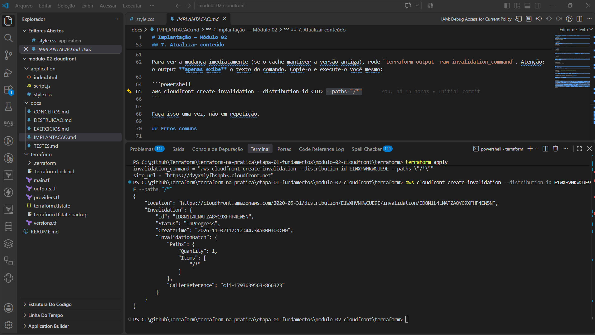
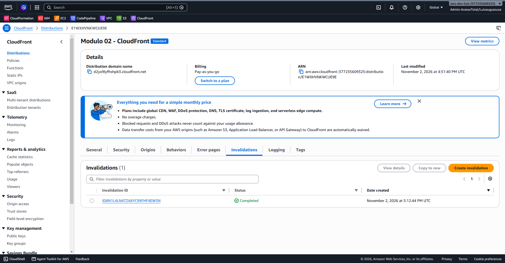

# Conceitos Terraform do Módulo 02

## Múltiplos recursos e o grafo de dependências

O Terraform lê todos os recursos, observa quem referencia quem e monta um **grafo**. Recursos independentes podem ser criados em paralelo; dependentes esperam.

```
bucket ──► distribuição ──► bucket policy
OAC ─────►
```

O resultado aparece na ordem do `apply`: a distribuição é a última a terminar, e a bucket policy só é criada depois dela.



*Figura 1: `aws_cloudfront_distribution.site` termina após 2m45s e só então `aws_s3_bucket_policy.site` é criada.*

## Referências e atributos computados

```hcl
domain_name = aws_s3_bucket.site.bucket_regional_domain_name
```

Formato: `<tipo>.<nome>.<atributo>`. Atributos como `arn`, `id` e `domain_name` da distribuição só são conhecidos **após** a criação. No plano aparecem como `(known after apply)`.



*Figura 2: `domain_name` e ARN foram gerados pela AWS e depois guardados no state. O `terraform show` exibe os mesmos valores.*



*Figura 3: atributos computados lidos do state.*

## Dependência implícita

A bucket policy usa `aws_cloudfront_distribution.site.arn`. Logo, o Terraform cria a distribuição **antes** da política. Você não escreveu a ordem; ela vem da referência.

## `depends_on` (dependência explícita)

```hcl
depends_on = [aws_s3_bucket_public_access_block.site]
```

Use apenas quando a dependência **existe na prática**, mas não aparece em nenhuma referência. Aqui, a AWS pode rejeitar duas alterações simultâneas no mesmo bucket. Se houver uma referência natural, prefira-a; `depends_on` é último recurso porque torna o plano mais conservador.

## Conceitos de apoio

Aparecem no código para o laboratório funcionar. O foco deste módulo são as referências e dependências acima.

| Conceito | Explicação curta | Onde aprofundar |
|---|---|---|
| `data "aws_cloudfront_cache_policy"` | Lê uma política gerenciada pela AWS pelo nome e evita ID fixo no código. Não cria nada | Uso contínuo |
| `locals` | Valores calculados reutilizáveis (`local.bucket_name`, `local.content_types`) | Módulo 03 |
| `fileset(pasta, "**")` | Função que lista os arquivos de uma pasta | Etapas futuras |
| `for_each` | Cria uma instância do recurso por item. Aqui: um `aws_s3_object` por arquivo, com endereço `aws_s3_object.files["index.html"]`. Adicionar um arquivo cria **um** novo objeto | Etapas futuras |
| `filemd5(...)` | Hash do arquivo local; se o arquivo mudar, o `plan` mostra `~` | Já visto no módulo 01 |
| `lookup`, `try`, `regex` | Funções que descobrem a extensão do arquivo (`regex`), evitam erro se não houver (`try`) e escolhem o Content-Type no mapa (`lookup`) | Etapas futuras |
| `jsonencode(...)` | Converte HCL em JSON (usado na bucket policy) | Módulo 03 |

## Criar, alterar e substituir

| Símbolo | Quando acontece | Exemplo neste módulo |
|---|---|---|
| `+` criar | Recurso novo | Primeiro apply |
| `~` alterar | Argumento mutável muda | Editar `script.js`; mudar `comment` da distribuição |
| `-/+` substituir | Argumento imutável muda (`forces replacement`) | Mudar o nome do bucket (`bucket`) |
| `-` destruir | Recurso removido do código | Apagar `script.js` da pasta |

Atenção: substituir um bucket com dados destrói o conteúdo. Aqui isso é aceitável porque o Terraform reenvia os arquivos.

Exemplos reais do laboratório:



*Figura 4: `~` alterar. Mudar o `comment` da distribuição não recria nada.*



*Figura 5: `+` criar. Um novo arquivo na pasta gera um novo `aws_s3_object`.*



*Figura 6: `~` alterar. Mudar o conteúdo de um arquivo altera o `etag` do objeto.*

## Ler um `terraform plan`

1. Veja o resumo final: `Plan: X to add, Y to change, Z to destroy`.
2. Procure `-/+` e `forces replacement`.
3. Confira os atributos `(known after apply)`.
4. Confirme que só os recursos esperados aparecem.

## Cache e Terraform

O Terraform atualiza o objeto no S3, **mas não limpa o cache do CloudFront**. Com a política `CachingOptimized`, uma versão antiga pode permanecer em cache por até 24 horas. Para ver a mudança imediatamente, crie uma invalidação manualmente (comando no output `invalidation_command`). Invalidações têm cota gratuita mensal; acima dela, cobrança por caminho.

## Segurança

O bucket tem Block Public Access completo. Acesso direto a `https://<bucket>.s3.us-east-1.amazonaws.com/index.html` retorna `403`. Somente a distribuição específica (condição `AWS:SourceArn`) lê os objetos.



*Figura 7: Block Public Access ativo e policy restrita ao ARN da distribuição.*



*Figura 8: o OAC (`Origin access`) faz o CloudFront assinar as requisições ao S3.*

## Cache e invalidação na prática



*Figura 9: o Terraform só exibe o comando. Quem cria a invalidação é a AWS CLI.*



*Figura 10: invalidação concluída no console.*
