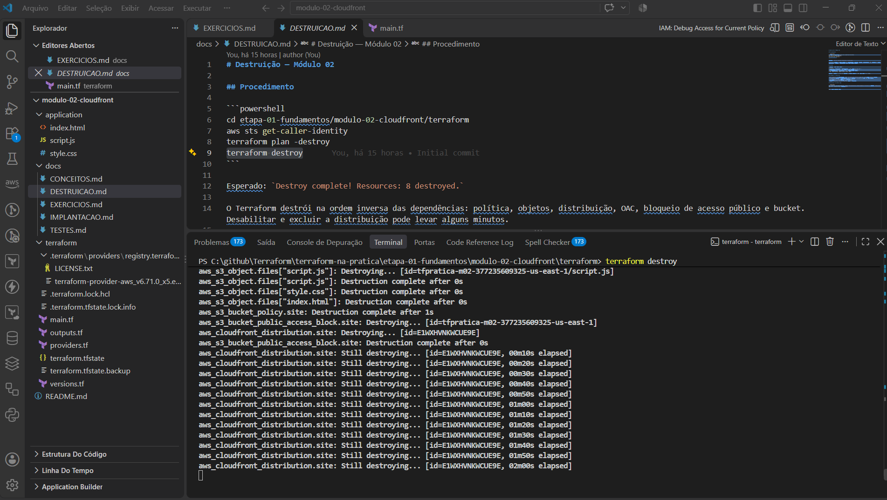
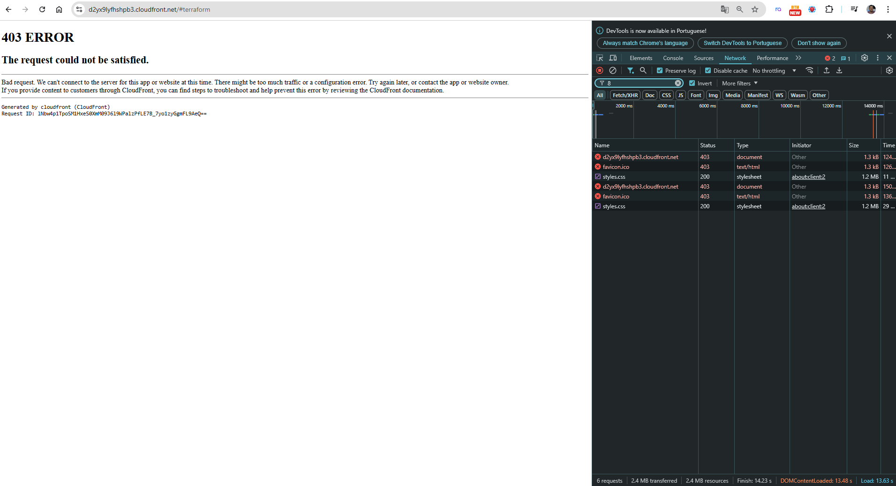

# Destruição — Módulo 02

## Procedimento

```powershell
cd etapa-01-fundamentos/modulo-02-cloudfront/terraform
aws sts get-caller-identity
terraform plan -destroy
terraform destroy
```

Esperado: `Destroy complete! Resources: 8 destroyed.`

O Terraform destrói na ordem inversa das dependências: política, objetos, distribuição, OAC, bloqueio de acesso público e bucket. Desabilitar e excluir a distribuição pode levar alguns minutos.



*Figura 1: o `destroy` remove primeiro os objetos S3 e a bucket policy. Depois o bloqueio de acesso público e, por fim, a distribuição, que fica em `Still destroying...` por alguns minutos.*

Durante a destruição, o site deixou de funcionar. Os objetos já tinham sido removidos, mas a distribuição ainda respondia:



*Figura 2: o CloudFront responde `403 ERROR` porque o bucket não tem mais os arquivos e o acesso é privado. Depois que a distribuição é excluída, a URL deixa de existir.*

## Custos

| Recurso | Pode gerar custo? |
|---|---|
| CloudFront (requisições e transferência) | Sim, acima do free tier |
| Invalidações CloudFront | Sim, acima da cota gratuita mensal |
| S3 (armazenamento e requisições) | Sim, valores muito baixos |
| OAC, bucket policy, public access block | Não |

Confira os preços e o free tier vigentes na página oficial da AWS, pois mudam com o tempo.

## Cuidados e limitações

- Se o `destroy` for interrompido, rode `terraform plan -destroy` para ver o que sobrou antes de repetir.
- O CloudFront precisa ser desabilitado antes de excluído; o provider faz isso, mas pode demorar.
- `force_destroy = true` apaga todo o conteúdo do bucket.
- Não apague o `terraform.tfstate` antes do destroy.
- Depois do destroy, a URL do CloudFront deixa de funcionar.

## Verificar se sobrou algo

```powershell
aws cloudfront list-distributions --query "DistributionList.Items[?Comment=='Terraform na Pratica - Modulo 02'].Id"
aws s3 ls | Select-String "tfpratica-m02"
```

Ambos devem retornar vazio.
