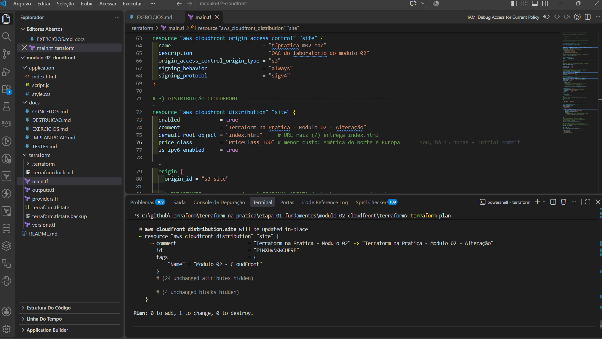
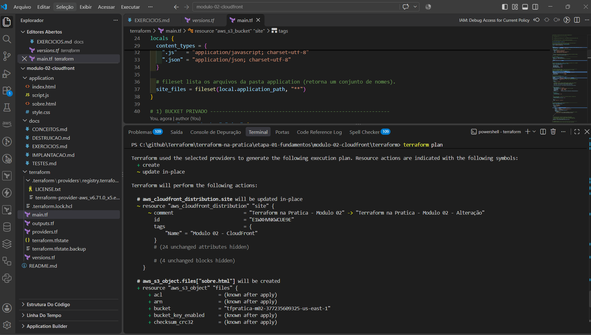
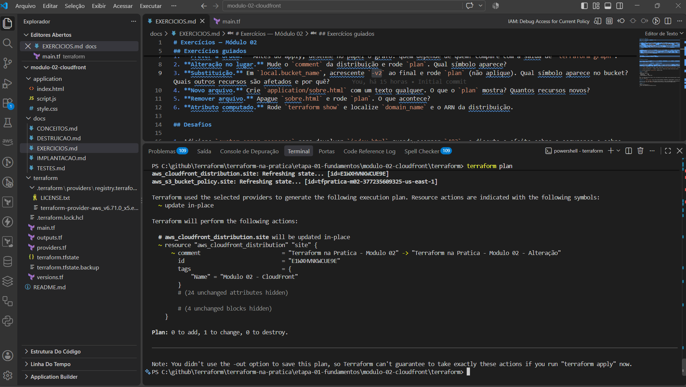
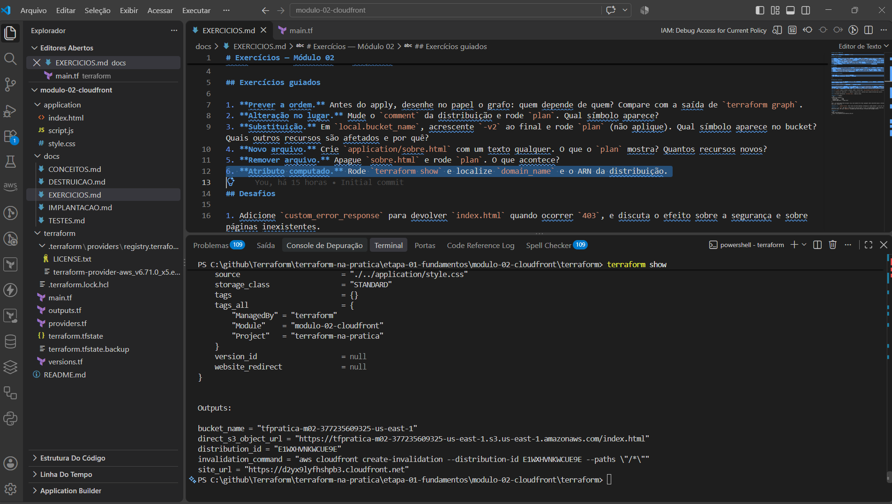

# Exercícios — Módulo 02

Tente antes de consultar as respostas no final.

## Exercícios guiados

1. **Prever a ordem.** Antes do apply, desenhe no papel o grafo: quem depende de quem? Compare com a saída de `terraform graph`.
2. **Alteração no lugar.** Mude o `comment` da distribuição e rode `plan`. Qual símbolo aparece?
3. **Substituição.** Em `local.bucket_name`, acrescente `-v2` ao final e rode `plan` (não aplique). Qual símbolo aparece no bucket? Quais outros recursos são afetados e por quê?
4. **Novo arquivo.** Crie `application/sobre.html` com um texto qualquer. O que o `plan` mostra? Quantos recursos novos?
5. **Remover arquivo.** Apague `sobre.html` e rode `plan`. O que acontece?
6. **Atributo computado.** Rode `terraform show` e localize `domain_name` e o ARN da distribuição.

### Evidências dos exercícios guiados

**Exercício 2 (alteração no lugar):** o `comment` foi alterado no `main.tf` e o `plan` mostrou `~ update in-place`.



*Figura 1: `Plan: 0 to add, 1 to change, 0 to destroy.` O `comment` é um atributo mutável, então não há substituição.*

**Exercício 4 (novo arquivo):** com `sobre.html` na pasta `application`, o `fileset` o incluiu.



*Figura 2: o `plan` mostra `+ create` para `aws_s3_object.files["sobre.html"]`. O `~` da distribuição vem da alteração pendente do `comment` do exercício anterior, não do novo arquivo.*

**Exercício 5 (remover arquivo):** `sobre.html` foi apagado antes de qualquer `apply`.



*Figura 3: como o arquivo nunca foi aplicado, o state não o conhecia. O `plan` não mostra `-`, só o `~` do `comment` (`1 to change`). Para ver `1 to destroy`, é preciso ter rodado o `apply` com o arquivo presente.*

**Exercício 6 (atributo computado):**



*Figura 4: `terraform show` lê o state e exibe todos os atributos, incluindo `tags_all` herdadas das `default_tags`, além dos outputs no final.*

## Desafios

1. Adicione `custom_error_response` para devolver `index.html` quando ocorrer `403`, e discuta o efeito sobre a segurança e sobre páginas inexistentes.
2. Troque `price_class` para `PriceClass_All`. Qual símbolo aparece? E por que isso pode alterar o custo?
3. Remova o `depends_on` da bucket policy. O `plan` muda? Por que o `plan` não é capaz de mostrar o risco?
4. Acrescente um output com o ARN da distribuição.

## Critérios de sucesso

- Você prevê `+`, `~` e `-/+` antes de executar.
- Você diferencia dependência implícita de explícita.

---

## Respostas comentadas

**1.** `bucket` e `OAC` não dependem entre si; ambos alimentam a distribuição; a policy depende da distribuição e do bucket. Os objetos dependem apenas do bucket.

**2.** `~ update in-place`. O comentário é um atributo mutável.

**3.** O nome do bucket é imutável: o bucket aparece com `-/+` e `forces replacement`. Os objetos S3 também são substituídos (pertencem ao bucket). A distribuição é alterada no lugar (`~`), pois o `domain_name` da origem muda, e a policy é recriada com o novo ARN. Isso é a dependência em ação. Leia o plano completo para confirmar; o detalhe exato depende da versão do provider.

**4.** O `fileset` passa a incluir o arquivo, então 1 recurso novo: `aws_s3_object.files["sobre.html"]`. Os existentes não mudam.

**5.** 1 recurso será destruído (`-`). Remover o arquivo local é declarar que o objeto não deve mais existir.

**6.** Os valores aparecem em `terraform show`, vindos do state.

**Desafio 1.** Exemplo:
```hcl
custom_error_response {
  error_code         = 403
  response_code      = 200
  response_page_path = "/index.html"
}
```
Isso é útil para aplicações de página única, mas esconde erros reais (qualquer chave inexistente passa a retornar a home). Neste site, não é necessário.

**Desafio 2.** `~ update in-place`. Mais locais de borda aumentam a abrangência e podem aumentar o custo por transferência.

**Desafio 3.** O `plan` não muda: a ordem fica por conta do grafo. O risco é de comportamento na AWS (operações simultâneas), que o plano não simula. Por isso `depends_on` documenta uma restrição que o Terraform não consegue inferir.

**Desafio 4.**
```hcl
output "distribution_arn" {
  value = aws_cloudfront_distribution.site.arn
}
```
