# Implantação — Módulo 02

> Nada foi implantado automaticamente. Execute cada passo e confira o resultado.

## 1. Credenciais

```powershell
aws sso login --profile <seu-perfil>
$env:AWS_PROFILE = "<seu-perfil>"
aws sts get-caller-identity
```

## 2. Inicializar

```powershell
cd etapa-01-fundamentos/modulo-02-cloudfront/terraform
terraform init
terraform fmt
terraform validate
```

Esperado: `successfully initialized` e `configuration is valid`.

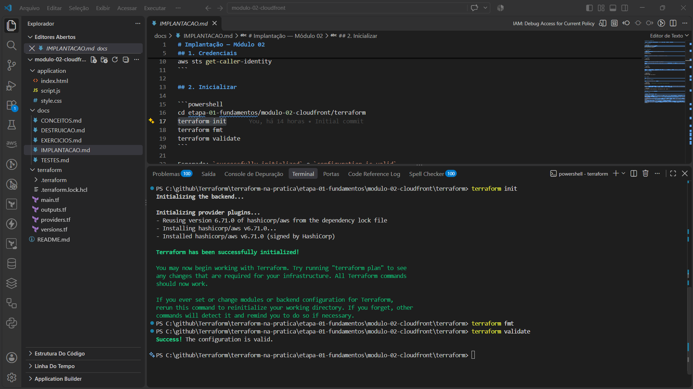

*Figura 1: `terraform init` instala o provider `hashicorp/aws` 6.71.0, e `terraform validate` responde `Success! The configuration is valid.`*

Os arquivos de configuração que o Terraform acabou de validar:

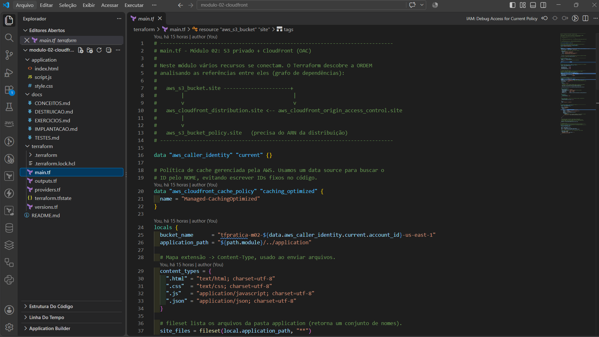

*Figura 2: `main.tf` com o `data` da política de cache, o `locals` (nome do bucket, mapa de Content-Type) e o `fileset` que lista os arquivos do site.*

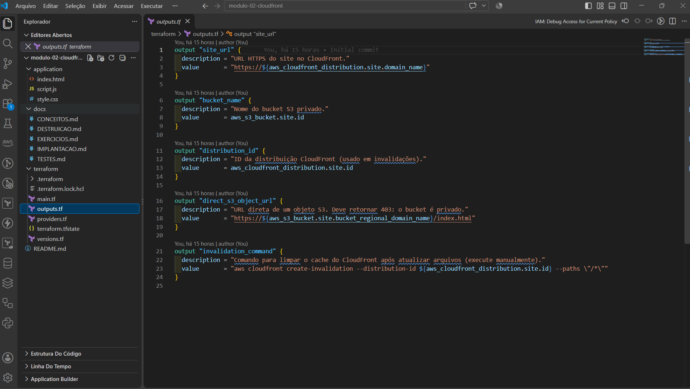

*Figura 3: `outputs.tf` define cinco saídas, entre elas `site_url` e `invalidation_command`.*

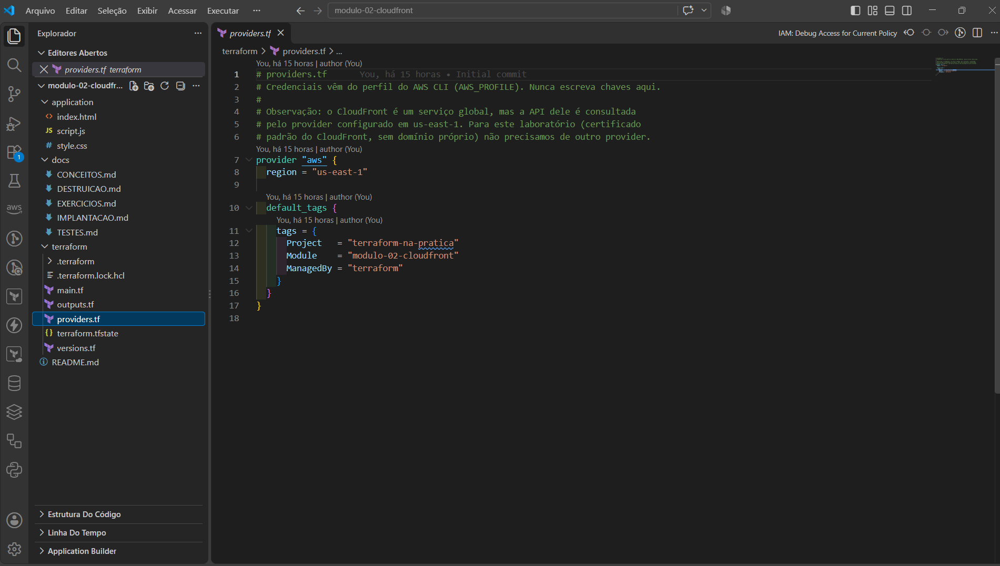

*Figura 4: `providers.tf` fixa a região `us-east-1` e aplica `default_tags` (`Project`, `Module`, `ManagedBy`) em todos os recursos. Nenhuma chave de acesso aparece no código.*

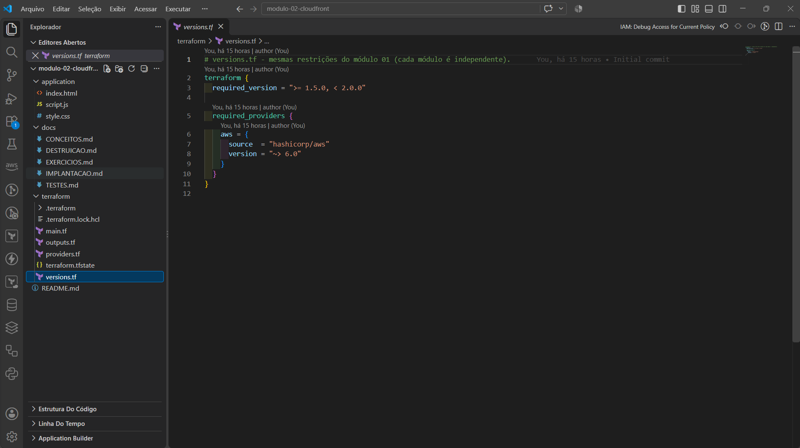

*Figura 5: `versions.tf` exige Terraform `>= 1.5.0, < 2.0.0` e o provider `hashicorp/aws ~> 6.0`.*

## 3. Planejar

```powershell
terraform plan
```

Esperado: `Plan: 8 to add, 0 to change, 0 to destroy.`

Observe `(known after apply)` em `arn`, `domain_name` e `id` da distribuição. Note também que a bucket policy é a última a ser criada.

## 4. Aplicar

```powershell
terraform apply
```

Digite `yes` após revisar. A distribuição pode levar de 3 a 10 minutos para ficar `Deployed`; o Terraform aguarda isso. Enquanto espera, ele imprime `Still creating...`.

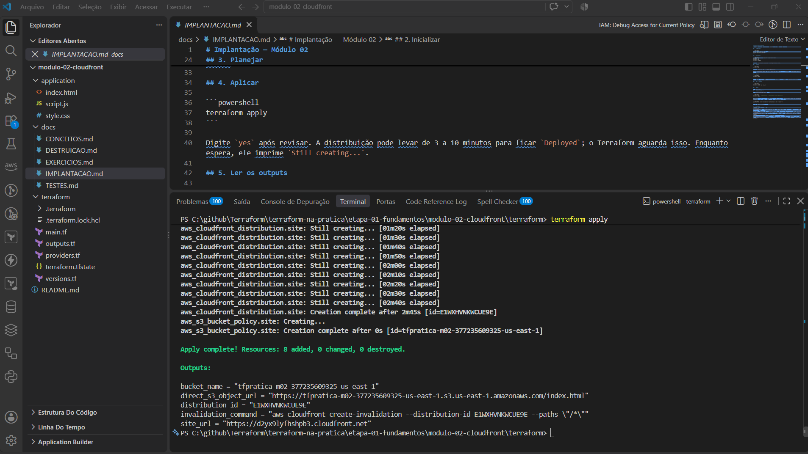

*Figura 6: a distribuição levou 2m45s para ser criada. A bucket policy veio logo depois, em 0s, pois depende do ARN da distribuição. Resultado: `Apply complete! Resources: 8 added, 0 changed, 0 destroyed.`*

Conferindo o que foi criado na AWS:

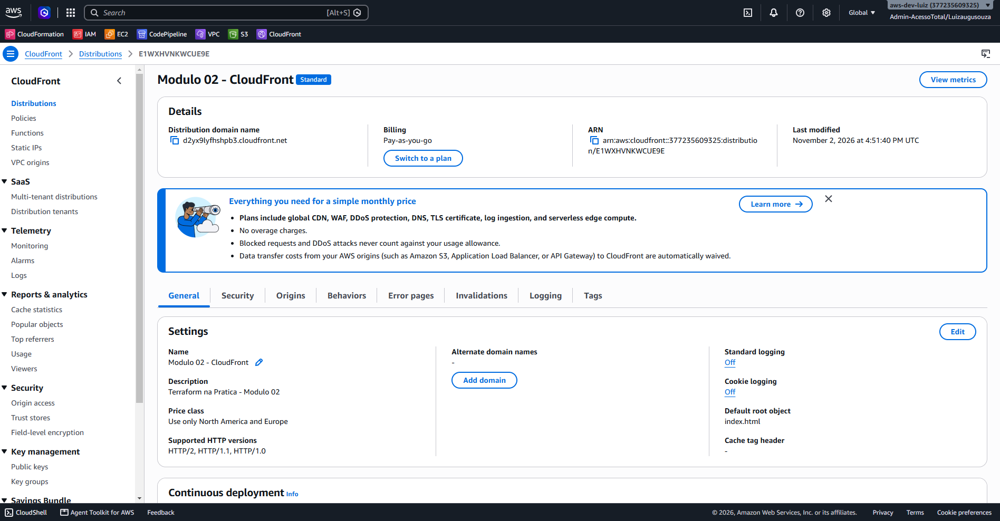

*Figura 7: console do CloudFront. O domínio `*.cloudfront.net` e o ARN são os atributos computados que o Terraform só conheceu após a criação.*

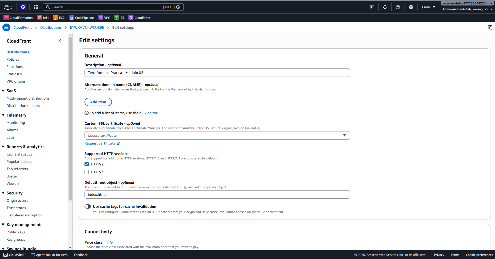

*Figura 8: configurações gerais. O `Default root object` é `index.html`, como definido em `default_root_object` no `main.tf`.*

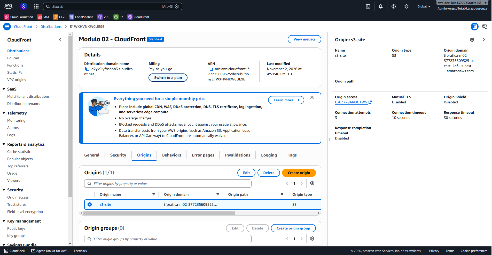

*Figura 9: a origem `s3-site` usa o endpoint regional do bucket e o OAC criado pelo Terraform (`Origin access`).*

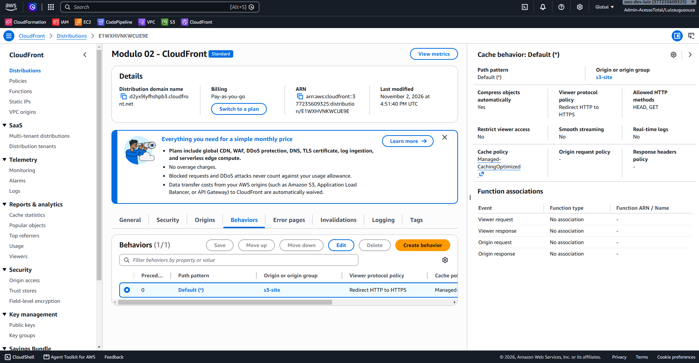

*Figura 10: o comportamento padrão redireciona HTTP para HTTPS, comprime objetos e usa a política `Managed-CachingOptimized`.*

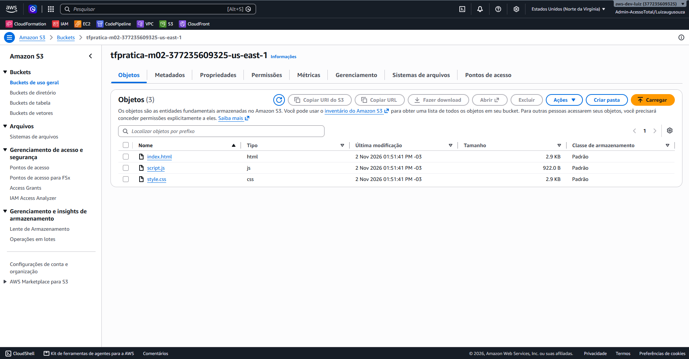

*Figura 11: o bucket contém os 3 objetos criados pelo `for_each` sobre o `fileset`.*

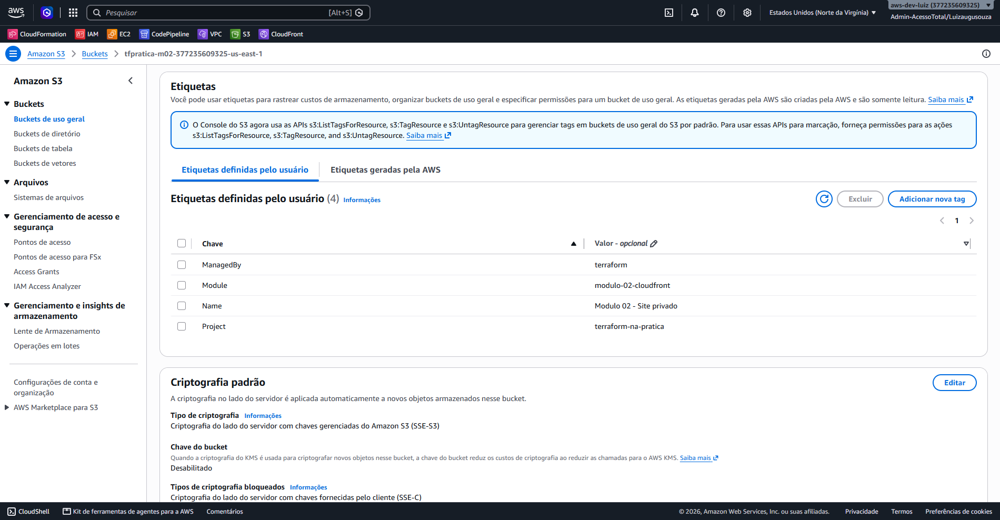

*Figura 12: as `default_tags` do provider chegam ao bucket, junto com a tag `Name` do próprio recurso.*

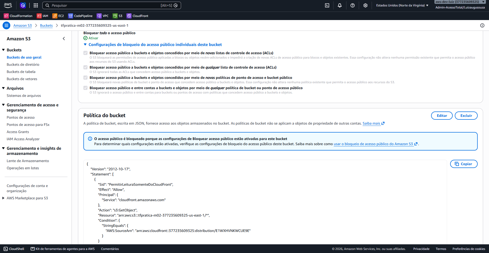

*Figura 13: todo acesso público está bloqueado, e a policy só permite `s3:GetObject` ao serviço `cloudfront.amazonaws.com` quando o `AWS:SourceArn` é o ARN desta distribuição.*

## 5. Ler os outputs

```powershell
terraform output
terraform output -raw site_url
```

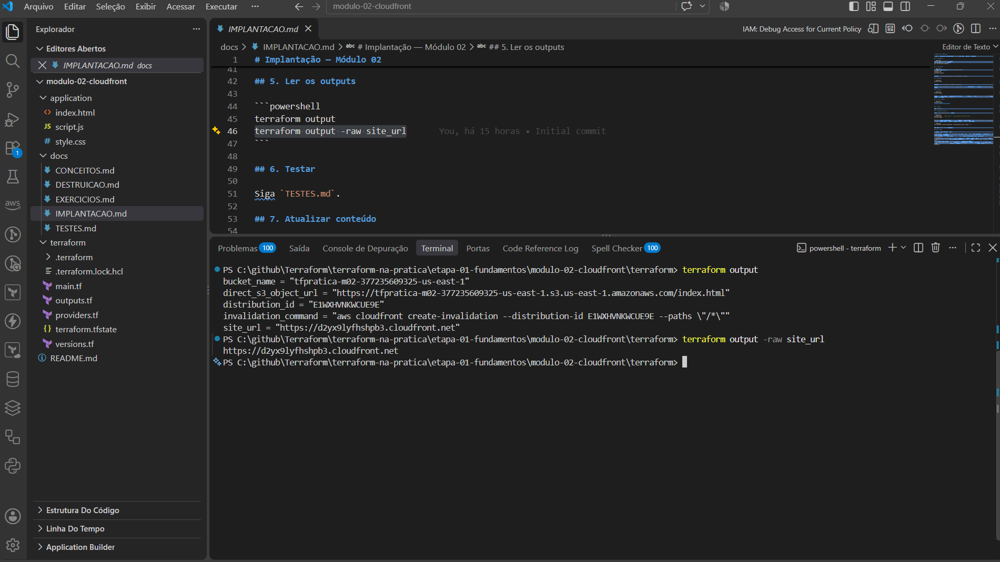

*Figura 14: `terraform output` lista as cinco saídas, e `-raw site_url` imprime só a URL, sem aspas.*

## 6. Testar

Siga `TESTES.md`.

## 7. Atualizar conteúdo

Edite `application/index.html`, depois:

```powershell
terraform plan     # deve mostrar ~ aws_s3_object.files["index.html"]
terraform apply
```

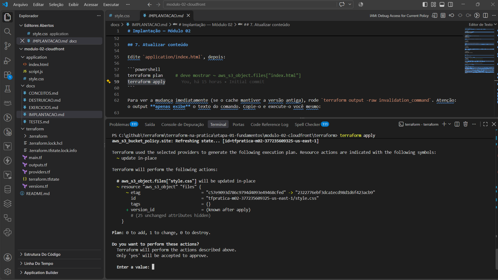

*Figura 15: neste teste a alteração foi feita em `style.css`. O `etag` mudou, então o plano mostra `~ update in-place` e `Plan: 0 to add, 1 to change, 0 to destroy`. Com `index.html` o comportamento é o mesmo.*

Para ver a mudança imediatamente (se o cache mantiver a versão antiga), rode `terraform output -raw invalidation_command`. Atenção: o output **apenas exibe** o texto do comando. Copie-o e execute-o você mesmo:

```powershell
aws cloudfront create-invalidation --distribution-id <ID> --paths "/*"
```

Faça isso uma vez, não em repetição.

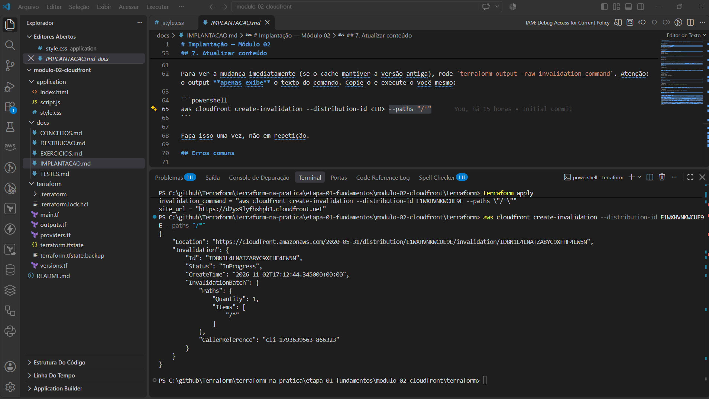

*Figura 16: o comando de invalidação devolve `Status: InProgress` e o `Id` da invalidação.*

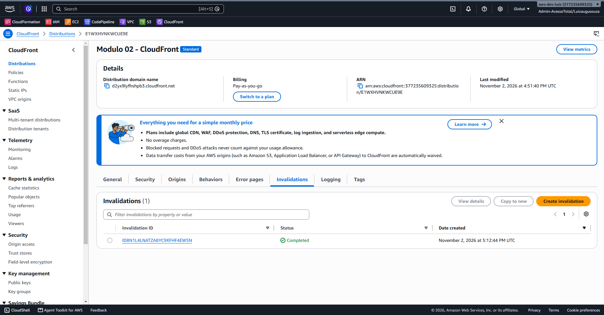

*Figura 17: no console, a invalidação aparece como `Completed`.*

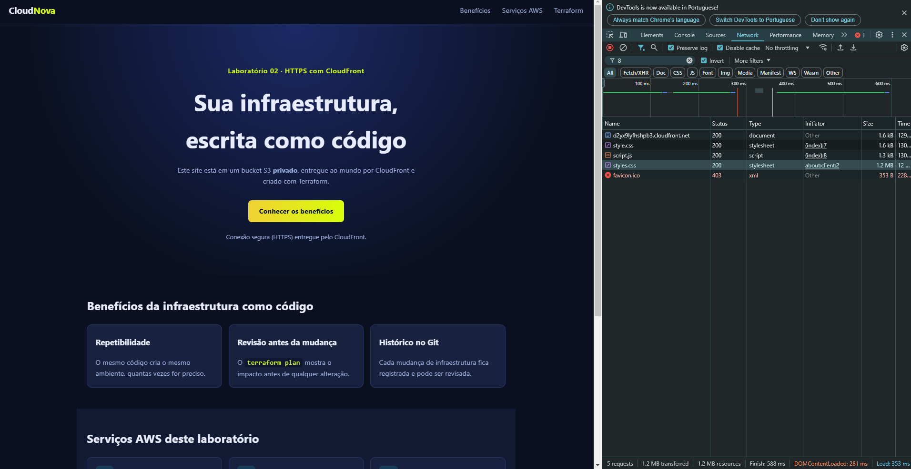

*Figura 18: depois da invalidação, o site já mostra o novo estilo (botão e destaques em amarelo). Os arquivos chegam com status 200 em poucos milissegundos.*

## Erros comuns

| Sintoma | Causa provável | Ação |
|---|---|---|
| `AccessDenied` ao abrir o site (CloudFront) logo após o apply | Policy ainda propagando ou distribuição não finalizada | Aguarde alguns minutos e recarregue |
| `403` ao abrir o site após alterar `bucket` | Policy antiga referenciando outra distribuição | Rode `terraform plan`; deve indicar `No changes` |
| `OriginAccessControlAlreadyExists` | OAC com mesmo nome já existe na conta | Mude o `name` do OAC ou remova o antigo |
| `OperationAborted` no S3 | Duas alterações simultâneas no bucket | Repita `terraform apply` uma vez; o `depends_on` reduz a chance |
| Site mostra versão antiga | Cache do CloudFront | Invalide manualmente |
| `AccessDenied` em `cloudfront:*` | Permissão IAM insuficiente | Solicite a permissão; não use chaves fixas |
| Erro `regex` em `main.tf` | Arquivo sem extensão em `application/` | O `try` já cobre; confira se não há pastas vazias ou nomes estranhos |
