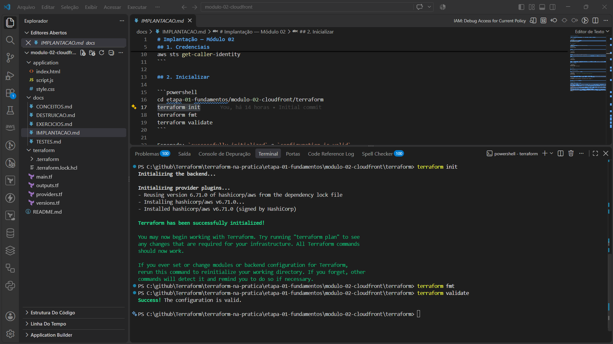
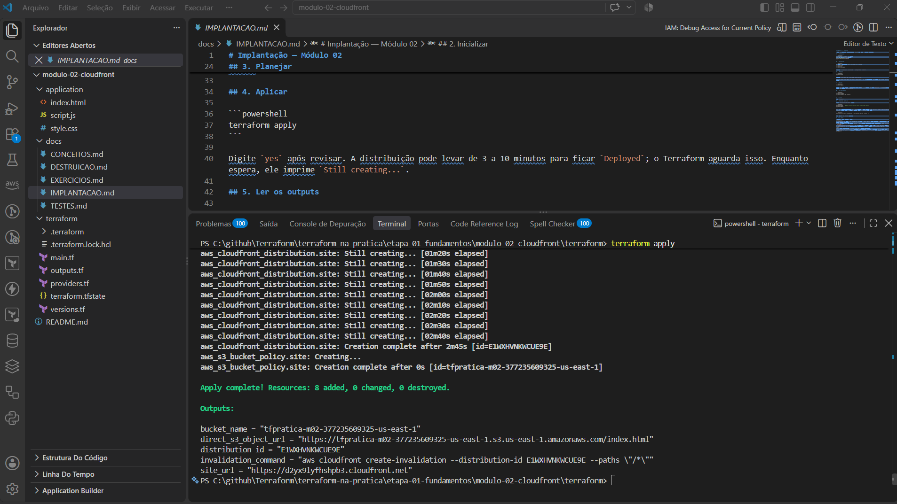
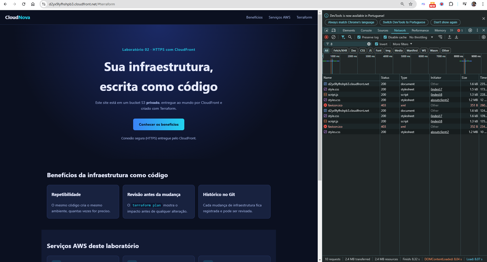
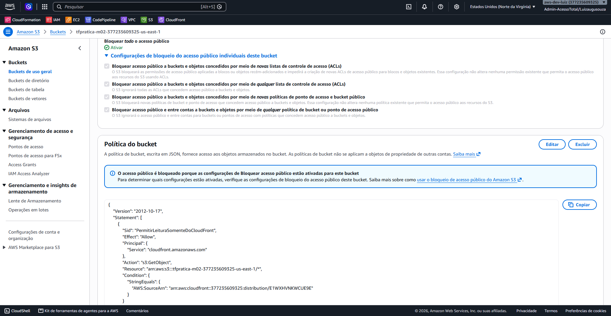
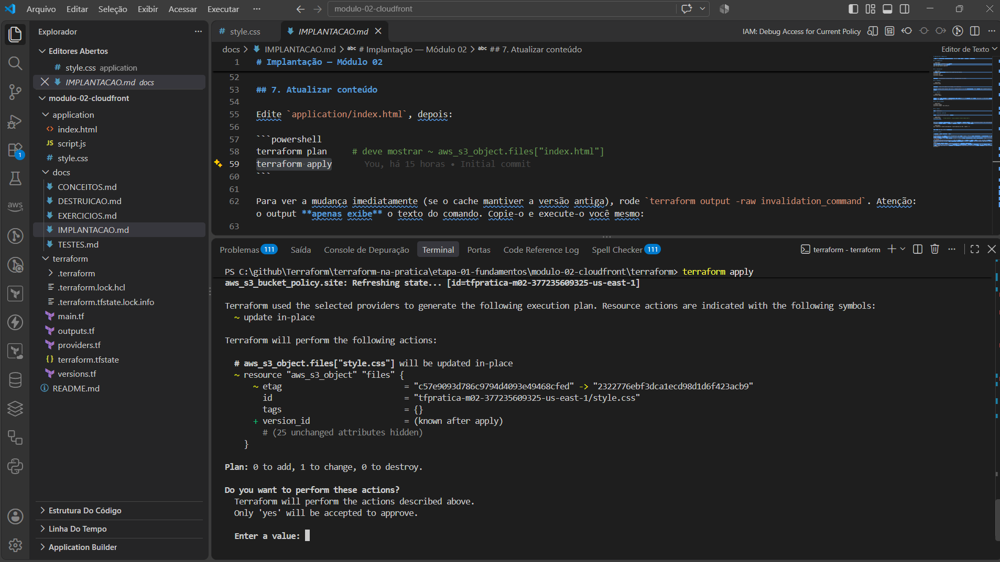
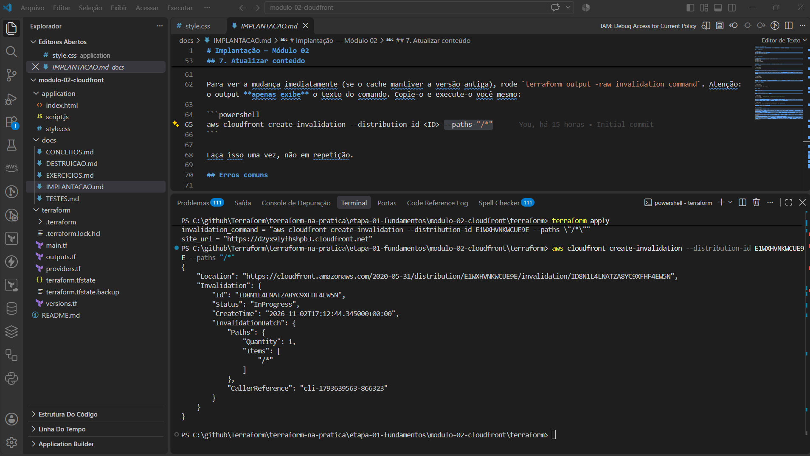
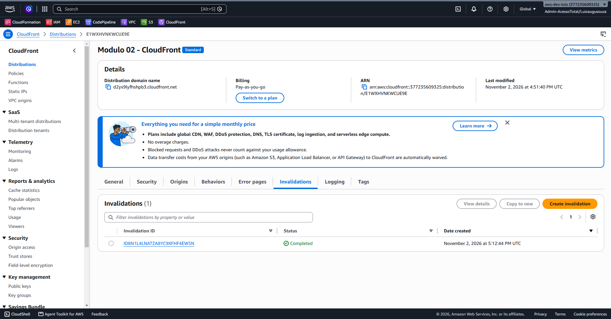
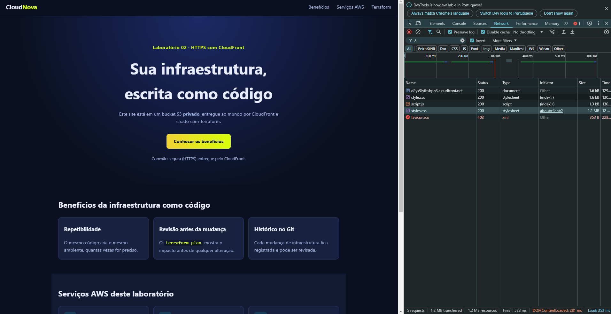

# Testes — Módulo 02

Preencha a coluna **Resultado obtido** com o que você observar. Este documento não contém resultados de execução.

| # | Teste | Como executar | Resultado esperado | Resultado obtido |
|---|---|---|---|---|
| 1 | Init/validate | `terraform init` e `terraform validate` | Inicializado; configuração válida | |
| 2 | Plano | `terraform plan` | `8 to add, 0 to change, 0 to destroy` | |
| 3 | Apply | `terraform apply` | `Apply complete! Resources: 8 added` | |
| 4 | HTTPS | Abrir `terraform output -raw site_url` | Landing page "CloudNova"; cadeado do navegador | |
| 5 | Redirect HTTP | Trocar `https` por `http` na URL | Redireciona para HTTPS | |
| 6 | Acesso direto ao S3 | Abrir `terraform output -raw direct_s3_object_url` | `403 AccessDenied` | |
| 7 | CSS e JS | F12 > Rede | `style.css` e `script.js` com status 200; menu mobile funciona | |
| 8 | Texto de status | Ver mensagem no hero | "Conexão segura (HTTPS)..." | |
| 9 | Sem divergências | `terraform plan` | `No changes.` | |
| 10 | Mudança detectada | Editar `index.html` e `terraform plan` | 1 recurso `~` (`files["index.html"]`) | |
| 11 | Cache | Após apply, recarregar a URL | Pode exibir conteúdo antigo até a invalidação | |
| 12 | Invalidação | Copiar e executar uma vez o comando exibido por `terraform output -raw invalidation_command` (o output não executa nada) | Após alguns instantes, conteúdo novo aparece | |
| 13 | Destroy | `terraform destroy` | `Destroy complete! Resources: 8 destroyed` | |

## Evidências

Capturas de tela da execução real do laboratório.

**Testes 1 a 3 (init, plano e apply):**



*Figura 1: `init` e `validate` concluídos.*



*Figura 2: `Apply complete! Resources: 8 added, 0 changed, 0 destroyed.`*

**Teste 4 e 7 (HTTPS, CSS e JS):**



*Figura 3: a landing page abre em `d2yx9lyfhshpb3.cloudfront.net`, e `style.css` e `script.js` retornam 200. O `favicon.ico` retorna 403 porque o site não tem esse arquivo; o S3 privado responde 403 para chaves inexistentes, e isso não indica falha.*

**Testes 6 e 9 (S3 privado):** a bucket policy e o bloqueio de acesso público mostram por que o acesso direto ao S3 é negado.



*Figura 4: só a distribuição com o ARN indicado em `AWS:SourceArn` pode ler os objetos.*

**Testes 10 a 12 (mudança, cache e invalidação):**



*Figura 5: o `plan` detecta a mudança do arquivo (`~`, 1 to change).*



*Figura 6: invalidação criada pelo comando copiado do output.*



*Figura 7: status `Completed`.*



*Figura 8: conteúdo novo servido pelo CloudFront.*

## Verificação adicional (curl)

```powershell
curl.exe -I (terraform output -raw site_url)
curl.exe -I (terraform output -raw direct_s3_object_url)
```

O primeiro deve retornar `200`; o segundo, `403`. Verifique os cabeçalhos `Content-Type` e, no primeiro, `X-Cache`.

## Critérios de sucesso

- [ ] Site abre por HTTPS.
- [ ] Acesso direto ao S3 é negado.
- [ ] Você explica por que a bucket policy só pode ser criada depois da distribuição.
- [ ] Você explica a diferença entre atualizar o objeto S3 e invalidar o cache.
